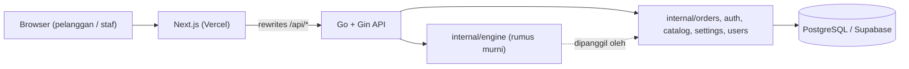
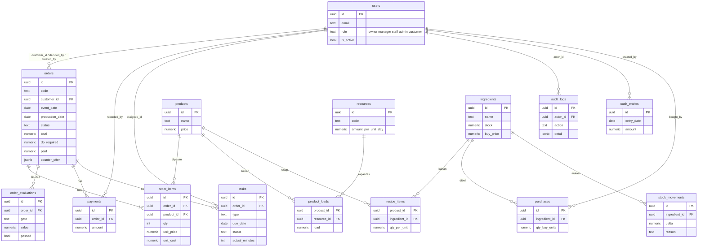

# Kalkurasa

> **Kalkulasi + Rasa — Dapur Pre-Order.** Sistem keputusan pesanan dan kapasitas untuk UMKM kuliner berbasis pre-order. Proyek untuk GTNIC 2026.

- Demo live: _(isi setelah deploy)_
- Repository: _(isi tautan GitHub publik)_
- Tangkapan layar: _(tambahkan ke `docs/screenshots/` lalu tautkan di sini)_

## 1. Masalah dan solusi

**Masalah.** UMKM kuliner pre-order biasanya menerima pesanan lewat chat. Pemilik menebak apakah dapur masih muat, apakah harga masih untung, dan apakah kas cukup untuk belanja bahan. Akibatnya terjadi pesanan menumpuk di satu hari, margin tipis karena diskon, kas kering sebelum pelunasan masuk, dan pesanan fiktif yang menahan kapasitas.

**Solusi.** Kalkurasa mengubah tebakan itu menjadi **empat gerbang keputusan** yang dihitung otomatis untuk setiap pesanan:

| Gerbang | Pertanyaan | Aturan |
|---|---|---|
| G1 Kapasitas | Dapur muat? | Utilisasi hari produksi ≤ batas terima (default 90%) |
| G2 Margin | Masih untung? | Margin ≥ margin minimum (default 20%) |
| G3 Kas | Kas aman? | Titik terendah kas dengan DP ≥ buffer kas |
| G4 Lead time | Cukup waktu? | Jarak ke tanggal acara ≥ lead time minimum |

Bila semua gerbang lolos dan pesanan kecil, pesanan **diterima otomatis**. Bila ada yang gagal, sistem menyiapkan **tawaran balik** (tanggal terdekat yang lolos, harga minimal, DP yang ditagih) dan pemilik memutuskan lewat kartu keputusan.

## 2. Fitur utama

- **Pelanggan:** katalog, cek ketersediaan tanggal, buat pesanan (wajib akun), lacak pesanan lewat kode, tanggapi tawaran balik, batas pesanan aktif belum DP per pelanggan.
- **Antrian keputusan** dengan `DecisionCard`: rekomendasi, status 4 gerbang, dampak (utilisasi, margin, titik terendah kas), terima/tawar/tolak, alasan override tercatat.
- **Kalender kapasitas** harian per sumber daya (oven, tenaga kerja) dengan status hijau/kuning/merah.
- **DP dinamis:** DP ditagih = maks(persen DP × total, DP minimal dari kas).
- **Pembayaran manual**, status pesanan (`confirmed` → `in_production` → `ready` → `delivering` → `completed`), pembatalan dengan eksposur pembatalan.
- **Tugas operasional** (belanja, produksi, antar) untuk karyawan, dengan durasi aktual.
- **Bahan dan belanja:** daftar belanja dari pesanan terkonfirmasi (buffer, pembulatan per satuan beli), pencatatan pembelian, koreksi stok, peringatan stok minimum.
- **Proyeksi kas 14 hari** dengan hari rawan, serta entri kas manual.
- **Dashboard per peran** (pemilik, manajer, karyawan, admin), **KPI** (ketepatan waktu, utilisasi, selisih biaya bahan, tingkat pembatalan, tawar balik/tolak, margin realisasi, hari kas rawan), dan **audit log**.
- **RBAC:** karyawan tidak pernah menerima harga, margin, atau kas.

## 3. Tech stack dan alasan

| Lapisan | Pilihan | Alasan singkat |
|---|---|---|
| Frontend | Next.js 15 (App Router), React 19, TypeScript, Tailwind CSS 3 | Rute per peran, middleware untuk proteksi, deploy mudah di Vercel |
| Backend | Go 1.26, Gin | Cepat, satu biner, cocok untuk perhitungan engine yang deterministik |
| Database | PostgreSQL (Supabase), driver pgx v5 | Transaksi dan `SELECT ... FOR UPDATE` untuk kunci hari; hosting terkelola |
| Angka | `shopspring/decimal` | Uang dan kuantitas tidak boleh memakai float |
| Auth | JWT dalam cookie `HttpOnly`, bcrypt/`x/crypto` | Sesi aman dari JavaScript, tanpa layanan eksternal |
| Hosting | Vercel (frontend), Vercel atau Railway/VPS (backend) | Lihat [docs/DEPLOY_CHECKLIST.md](docs/DEPLOY_CHECKLIST.md) |

Semua rumus bisnis berada di paket `backend/internal/engine` (fungsi murni, diuji TC-01 s.d. TC-07). Handler dan frontend tidak menghitung ulang.

## 4. Arsitektur



Browser hanya berbicara dengan domain frontend; Next.js meneruskan `/api/:path*` ke `GIN_API_URL`, sehingga cookie sesi tetap satu origin.

## 5. Diagram relasi tabel



Tabel pendukung tanpa relasi: `settings` (parameter bisnis), `day_locks` (kunci kapasitas per hari), `rate_limits` (pembatas laju), `schema_migrations`. Skema lengkap ada di `backend/migrations/`.

## 6. Menjalankan secara lokal

Prasyarat: Go 1.26+, Node.js 20+, dan database PostgreSQL (disarankan proyek Supabase).

```bash
# Backend
cd backend
cp .env.example .env        # isi DATABASE_URL, JWT_SECRET, dst. (lihat bagian 8)
go run ./cmd/api            # http://127.0.0.1:8080

# Frontend (terminal lain)
cd frontend
npm install
cp .env.example .env.local  # GIN_API_URL=http://localhost:8080
npm run dev                 # http://localhost:3000
```

Pemeriksaan kualitas:

```bash
go vet -C backend ./...
go test -C backend ./... -count=1
go test -C backend -tags=integration ./... -count=1   # butuh DATABASE_URL, menulis ke DB
npm --prefix frontend run lint
npm --prefix frontend run build
```

## 7. Migrasi dan seed

```bash
cd backend
go run ./cmd/migrate   # menerapkan migrations/*.sql memakai DATABASE_URL_MIGRATE
go run ./cmd/seed      # katalog + ~40 pesanan demo + skenario S1-S5 (idempoten)
```

- Seed memerlukan `SEED_DEMO_PASSWORD` (minimal 8 karakter). Nilainya **tidak** disimpan di repo.
- Seed idempoten: dijalankan ulang akan mengosongkan data transaksi dan membuatnya kembali. Tanggal pesanan relatif terhadap `Today()` (Asia/Jakarta, bisa dioverride lewat setting `demo_today`).
- Admin dapat mereset data demo lewat `POST /api/v1/admin/reset-demo`.
- Skenario demo: **S1** pesanan 100 snack box di hari penuh (G1 gagal, tawar balik ke hari berikutnya), **S2** harga Rp 21.000 (margin 9,5%, harga minimal Rp 23.750), **S3** DP minimal Rp 600.000 dengan DP ditagih Rp 712.500, **S4** daftar belanja (tepung perlu 12,84 kg, beli 13 kg), **S5** pembatalan (eksposur Rp 587.500).

## 8. Variabel lingkungan

Tanpa nilai rahasia. Salin dari `.env.example`; file `.env` sudah di-`.gitignore`.

**Backend (`backend/.env`)**

| Variabel | Fungsi |
|---|---|
| `PORT` | Port server (default `8080`) |
| `DATABASE_URL` | Koneksi aplikasi (Supabase Transaction pooler) |
| `DATABASE_URL_MIGRATE` | Koneksi migrasi/seed (Session pooler), hanya lokal |
| `DB_MAX_CONNS` | Maks. koneksi per instance (default `3`) |
| `JWT_SECRET` | Kunci penanda tangan sesi, acak minimal 32 karakter |
| `APP_ENV` | `development` atau `production` |
| `ALLOWED_ORIGINS` | Daftar origin CORS dipisah koma |
| `COOKIE_SECURE` | `true` di produksi (HTTPS) |
| `TZ` | Zona waktu (default `Asia/Jakarta`) |
| `SEED_DEMO_PASSWORD` | Kata sandi akun demo saat seed |

**Frontend (`frontend/.env.local`)**

| Variabel | Fungsi |
|---|---|
| `GIN_API_URL` | URL backend tujuan rewrites `/api/*` |
| `NEXT_PUBLIC_APP_NAME` | Nama aplikasi di UI |

## 9. Akun demo

Semua akun memakai satu kata sandi yang ditetapkan lewat `SEED_DEMO_PASSWORD` dan **dibagikan terpisah, tidak ditulis di repo**.

| Email | Peran | Mendarat di |
|---|---|---|
| `owner@demo.test` | Pemilik | `/app/owner` |
| `manager@demo.test` | Manajer operasional | `/app/manajer` |
| `staff@demo.test` | Karyawan produksi | `/app/karyawan` |
| `admin@demo.test` | Admin sistem | `/app/admin` |
| `customer@demo.test` | Pelanggan demo | `/pesanan-saya` |
| `pelanggan2@demo.test` | Pelanggan (pesanan menunggu keputusan) | `/pesanan-saya` |
| `pelanggan3@demo.test` | Pelanggan (pesanan menunggu DP) | `/pesanan-saya` |

Pelanggan baru dapat mendaftar sendiri di `/daftar`.

## 10. Batasan yang diketahui

Satu usaha saja (belum multi-tenant), tanpa notifikasi (email/WhatsApp), pembayaran dicatat manual tanpa payment gateway, tanpa akuntansi lengkap maupun pajak, dan cold start Vercel dapat membuat request pertama lebih lambat. Rencana pengembangan ada di [docs/PROPOSAL_MATERIALS.md](docs/PROPOSAL_MATERIALS.md).

## 11. Struktur repo

```
frontend/   Next.js (App Router, TypeScript, Tailwind)
backend/    Go (Gin, pgx): cmd/{api,migrate,seed}, internal/{engine,orders,auth,catalog,settings,users}, migrations/
docs/       Spesifikasi, ASSUMPTIONS, PROPOSAL_MATERIALS, TEST_CHECKLIST, DEPLOY_CHECKLIST
```

---

*Data simulasi — proyek GTNIC 2026.*
