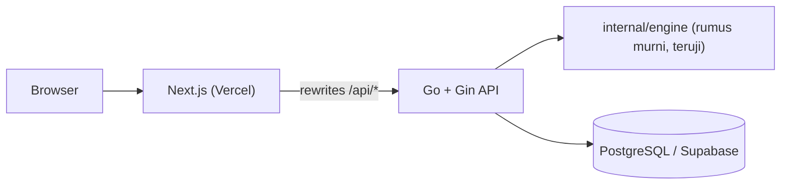

# Materi Proposal PDF — Kalkurasa (GTNIC 2026)

Rancangan isi per halaman/bagian untuk proposal PDF. Semua angka berasal dari data simulasi. Diagram Mermaid dapat diekspor menjadi gambar (mermaid.live) lalu ditempel ke PDF.

> Catatan transparansi: proyek dibangun dengan bantuan AI coding assistant. Cantumkan satu kalimat ini di halaman "Tentang proyek".

## 1. Latar masalah dan solusi

- **Masalah:** UMKM kuliner pre-order memutuskan pesanan dengan tebakan: kapasitas dapur, margin, dan kas.
- **Dampak (simulasi):** pesanan menumpuk di satu hari, diskon menekan margin, kas kering sebelum pelunasan, pesanan fiktif menahan kapasitas.
- **Solusi:** empat gerbang keputusan otomatis (G1 kapasitas, G2 margin, G3 kas, G4 lead time) yang menghasilkan rekomendasi terima, tawar balik, atau tolak.

## 2. Fitur utama: keputusan kapasitas dan kas

### 2.1 Keputusan kapasitas (G1)
- Kapasitas efektif harian = jumlah unit × jam/menit per hari × efisiensi, per sumber daya (oven, tenaga kerja).
- Utilisasi hari = beban terbesar dibanding kapasitas; sumber daya penghambat ditampilkan.
- Batas terima 90%; status hijau < 70%, kuning < 90%, merah di atasnya.
- **Skenario S1:** 100 snack box di hari yang sudah terisi → utilisasi tenaga 155,5% (G1 gagal) → sistem menawarkan hari berikutnya dengan utilisasi 88,2%.

### 2.2 Keputusan kas (G3) dan DP dinamis
- Proyeksi kas harian: saldo(t) = saldo(t−1) + peristiwa kas hari t − biaya tetap harian.
- DP minimal = maks(0, buffer kas − titik terendah tanpa DP); DP ditagih = maks(persen DP × total, DP minimal).
- **Skenario S3:** DP minimal Rp 600.000, DP ditagih 30% × Rp 2.375.000 = Rp 712.500.
- **Pembatalan (S5):** eksposur = maks(0, belanja terpesan − DP diterima) = Rp 1.300.000 − Rp 712.500 = Rp 587.500.

### 2.3 Margin dan tawaran balik (G2)
- **Skenario S2:** harga Rp 21.000 vs biaya Rp 19.000 → margin 9,5% < 20% → harga minimal Rp 23.750.
- Tawaran balik berisi tanggal terdekat yang lolos G1/G3/G4, harga minimal per item, dan DP.

### 2.4 Bahan dan belanja
- **Skenario S4:** kebutuhan tepung 6 tart × 0,4 kg + 100 snack box × 0,12 kg = 14,4 kg; stok 3 kg; buffer 10% → perlu 12,84 kg; dibeli 13 kg.

### 2.5 Fitur pendukung
Dashboard per peran, KPI (7 indikator), audit log, tugas karyawan, RBAC (karyawan tidak melihat harga/margin/kas), batas pesanan aktif belum DP per pelanggan untuk mencegah pesanan fiktif.

## 3. Arsitektur

Poin penjelasan: satu origin untuk cookie sesi; engine murni tanpa akses DB sehingga mudah diuji; kunci hari (`day_locks` + `SELECT FOR UPDATE`) mencegah dua pesanan berebut kapasitas yang sama.

## 4. Diagram database

Tempel diagram ER dari [README.md bagian 5](../README.md#5-diagram-relasi-tabel). Tabel inti: `users`, `orders`, `order_items`, `order_evaluations`, `payments`, `tasks`, `products`, `resources`, `product_loads`, `ingredients`, `recipe_items`, `purchases`, `stock_movements`, `cash_entries`, `audit_logs`, `settings`, `day_locks`, `rate_limits`.

## 5. Teknologi dan alasan

| Teknologi | Alasan |
|---|---|
| Next.js 15 + React 19 + TypeScript | Routing per peran, middleware, tipe aman antar-halaman |
| Tailwind CSS 4 | Antarmuka konsisten dan cepat dibangun, responsif |
| Go + Gin | Performa, biner tunggal, cocok untuk engine perhitungan |
| PostgreSQL (Supabase) + pgx | Transaksi dan penguncian baris untuk konsistensi kapasitas |
| shopspring/decimal | Presisi uang, tanpa galat float |
| JWT cookie HttpOnly | Sesi aman dari XSS, tanpa layanan eksternal |
| Vercel | Deploy otomatis dari GitHub, domain publik untuk juri |

## 6. Keunikan

1. Keputusan **berbasis empat gerbang** yang transparan: setiap rekomendasi disertai nilai, ambang, dan alasan.
2. **Tawaran balik otomatis** (tanggal, harga minimal, DP), bukan sekadar terima/tolak.
3. **DP dinamis dari kas**: DP mengikuti kondisi kas, bukan persentase tetap.
4. **Kapasitas dan kas dalam satu keputusan**, bukan dua alat terpisah.
5. **Engine murni dengan tes kasus uji** (TC-01 s.d. TC-12) dan tes integrasi pada PostgreSQL asli, termasuk uji persaingan dua pesanan serentak.
6. Pencegahan pesanan fiktif: akun pelanggan wajib, batas pesanan aktif belum DP, kedaluwarsa DP dengan pengecekan malas.

## 7. Batasan saat ini

- Belum multi-usaha: satu usaha per instalasi.
- Tanpa notifikasi (email/WhatsApp/push); pelanggan melacak lewat kode.
- Pembayaran dicatat manual, belum terhubung payment gateway.
- Tanpa akuntansi lengkap dan tanpa perhitungan pajak.
- Tidak ada job terjadwal; kedaluwarsa DP memakai pengecekan malas.
- Data dan klaim dampak adalah simulasi.

## 8. Rencana pengembangan

| Prioritas | Pengembangan | Uraian |
|---|---|---|
| 1 | **Dukungan multi-usaha (multi-tenant)** | Pemisahan data per usaha (`tenant_id`), peran per usaha, parameter bisnis per usaha, onboarding mandiri. |
| 2 | **Fitur akuntansi lengkap** | Buku besar, jurnal otomatis dari pesanan/pembayaran/pembelian, laporan laba rugi dan neraca, rekonsiliasi kas. |
| 3 | **Kalkulasi PPN dan pajak** | PPN per produk/pesanan, faktur pajak, pajak UMKM final, pelaporan periodik. |
| 4 | **Integrasi biaya aplikasi pihak ketiga** | Komisi dan biaya platform (marketplace, aplikasi pesan-antar, payment gateway) masuk ke biaya pokok dan margin G2. |
| 5 | Notifikasi | Pengingat DP, status pesanan, dan tawar balik lewat WhatsApp/email. |
| 6 | Payment gateway | Verifikasi pembayaran otomatis menggantikan pencatatan manual. |
| 7 | Simulasi dan kalibrasi | Simulasi 30 hari, kalibrasi durasi produksi dari data aktual (BR-12). |

## 9. Kerangka halaman PDF yang disarankan

1. Sampul + tim + tautan demo dan repository
2. Latar masalah dan solusi
3. Fitur utama (kapasitas, kas, DP, tawar balik) dengan tangkapan layar `DecisionCard` dan kalender kapasitas
4. Alur skenario S1–S5
5. Arsitektur
6. Diagram database
7. Teknologi dan alasan
8. Keunikan
9. Batasan dan rencana pengembangan
10. Penutup + pernyataan penggunaan AI coding assistant

## 10. Aset yang perlu disiapkan

- [ ] Tangkapan layar: dashboard pemilik, antrian keputusan, kalender kapasitas, proyeksi kas, daftar belanja, dashboard karyawan.
- [ ] Ekspor diagram Mermaid (arsitektur, ER) ke PNG/SVG.
- [ ] Tautan demo live dan repository publik.
- [ ] Label "data simulasi" pada setiap angka dampak.

